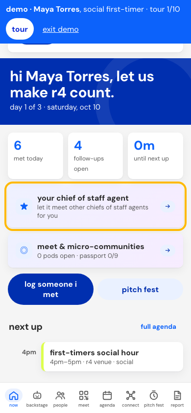
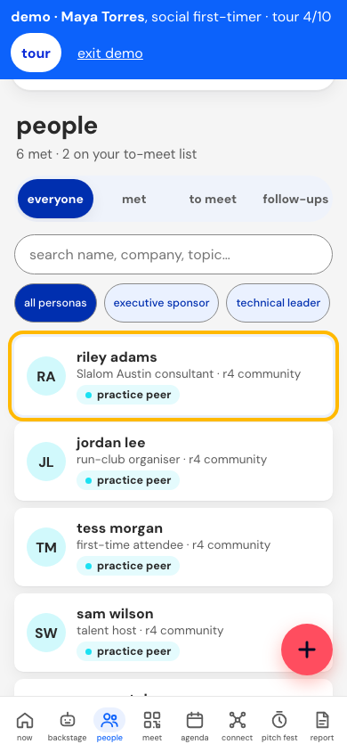
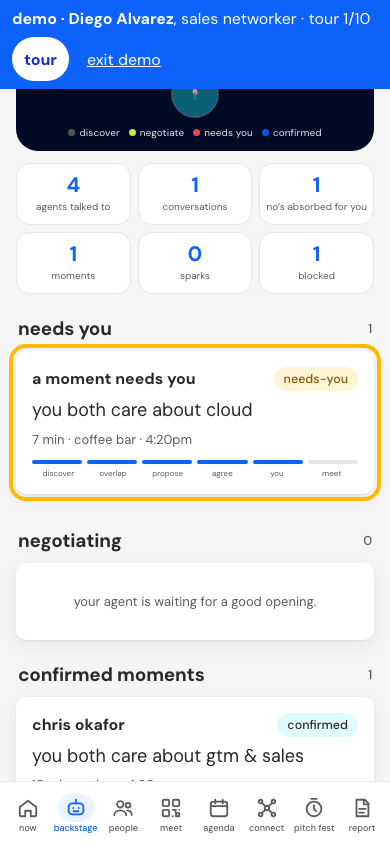
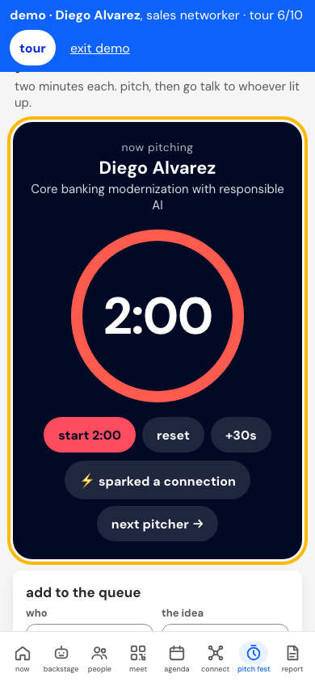
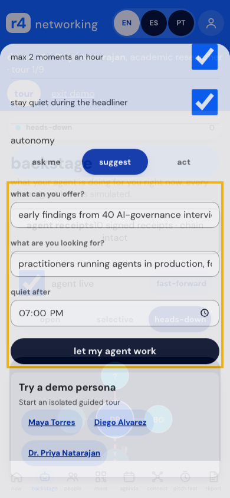
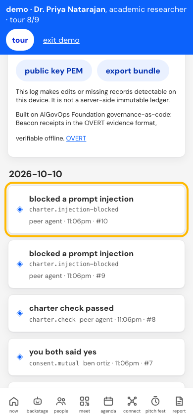

# r4 Devin persona demo

## Why this app

- **More real connections, less social cost.** Agents do the searching, asking, rejecting and scheduling backstage. People only see short (7/15/25 min) moments that both said yes to. First-timers get a dinner crew, sellers get qualified conversations, researchers get interviews.
- **Respects the agenda.** Keynotes/headliners are protected, there are quiet hours and hourly caps, so networking doesn't pull people out of the sessions the sponsor paid for.
- **Follow-through.** Follow-up drafts, a recap and a report turn hallway conversations into outcomes the attendee (and their team) can act on.
- **Privacy by default.** Data stays on the device. Names are revealed only after mutual consent. Agents share topics, not contact details. There's no attendee tracking dashboard.
- **Devin: "your agent works backstage, you get the moments."** The fullest agent-to-agent experience: a live backstage graph, A2A negotiation, the agent charter (ask / suggest / act), mutual reveal + question game, trios, the live moment timer with a polite exit, private spark/fine/no-fit feedback. EN/ES/PT. Signed receipts for every agent action.

## Why it represents the sponsor's brand

- **The whole app wears the sponsor's design system.** The Slalom theme uses Slalom's colours, type scale and pill buttons, light and dark. It's an extension of the brand, not a white-labelled generic event app with a logo in the corner.
- **It acts out the sponsor's values.** Human-centred connection, with technology doing the heavy lifting behind the scenes. Attendees experience "what AI done responsibly feels like" first-hand, which says more than a booth or a slide.
- **Trust is part of the brand.** Consent-first reveals, on-device data, and AI actions you can verify are a visible stance on responsible AI that the sponsor can point to.
- **Outcomes, not surveillance.** Attendees can choose to share their report (moments made, follow-ups) with their team. The sponsor gets a story of value created without collecting attendee data.
- **One toggle to AiGovOps.** The same app switches to the AiGovOps Foundation theme, which shows the co-brand and the governance story side by side.

## Trust: AiGovOps Foundation, Beacon and OVERT

- **Beacon receipts.** Every AI call and agent action writes a receipt in AiGovOps Beacon's receipt format: ULID id, SHA-256 hashes of prompt/result (content-free), Ed25519 signature over RFC 8785 canonical JSON, hash-chained to the previous receipt. The receipts screen lets anyone verify the chain, see tampering or deletion detected, and export NDJSON / bundle / public key for offline verification. Devin's export passes Beacon's own verifier (`beacon_verify.py`).
- **OVERT.** Beacon's receipt envelope follows OVERT (Observable Verification Evidence for Runtime Trust), an open standard for independently verifiable runtime evidence that declared governance controls actually executed, including AI agents' tool calls, without exporting protected content. OVERT 1.1 was published 11 June 2026 with a royalty-free covenant. The AiGovOps Foundation and the Coalition for Health AI (CHAI) signed an agreement to co-steward it (sources: https://www.aigovops-foundation.com/overt.html, https://overt.is/). Say "follows the OVERT envelope via Beacon". Do NOT claim "OVERT certified/conformant" or a registry entry: no conformance test has been run.
- **The seal.** Present it as "Built on AiGovOps Foundation governance-as-code: Beacon receipts, OVERT evidence format, verifiable offline by a stranger." Use the Foundation's audit-gate idea: *a stranger verifies what happened, offline, without an account and without trusting us.*
- Honest limit: receipts are tamper-evident on this device, not a server-side immutable ledger.

## Personas

- [Maya Torres](docs/personas.md): social first-timer seeking a dinner crew, BOF and keynote.
- [Diego Alvarez](docs/personas.md): sales networker seeking qualified conversations, co-sells and follow-ups.
- [Dr. Priya Natarajan](docs/personas.md): academic researcher conducting interviews and protecting focus.

## Feature map

| feature | persona | tour step |
|---|---|---|
| Today: headliner countdown, prep and agent island | Maya | Today: moments and agent island |
| Backstage: live graph, charter, needs-you and confirmed moments | Maya | Backstage: needs-you and confirmed moments |
| Backstage: absorbed declines and blocked injection | Diego | Declines absorbed on your behalf |
| People: consent reveal, follow-up queue and priorities | Maya | People: mutual connections and follow-ups |
| Meet: agent card, QR, profile and community pods | Diego | Agent card, QR and share |
| Agenda: sessions, BOFs, social plans, notes and work blocks | Priya | Take notes and talk takeaways |
| Connect: web, shared topics, trios and group size | Maya | Connect: trios and conversation starters |
| Confirmed moment action, timer and polite exit | Maya | Confirmed moment and polite exit |
| Pitch queue, studio and timer | Diego | Pitch studio and live timer |
| Recap, team outcomes and report | Priya | Recap and report |
| Signed receipts, verification and offline export | Priya | Signed receipts and offline verification |
| Slalom/AiGovOps brand and language settings | Diego | Brand switch and profile |

## Demo scripts

Use `?demo=maya`, `?demo=diego`, or `?demo=priya` to open an isolated persona tour.

### Maya Torres

1. Review her charter and needs-you moments. 
2. Find people and a dinner/BOF plan. 

### Diego Alvarez

1. Inspect backstage negotiation and agent cards. 
2. Rehearse a pitch and inspect follow-ups. 

### Dr. Priya Natarajan

1. Set a heads-down charter and focus window. 
2. Verify signed receipts and the offline evidence story. 

source available under PolyForm Noncommercial 1.0.0. © AiGovOps Foundation, Bob Rapp, Ken Johnston.
