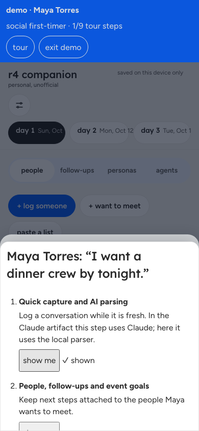
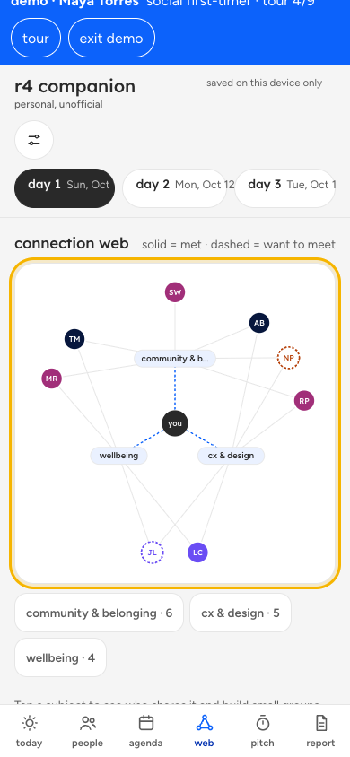
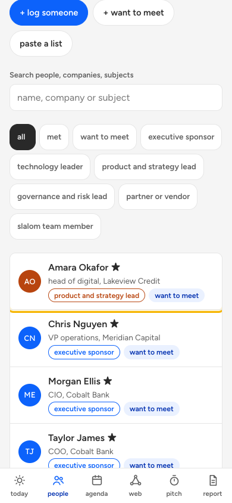
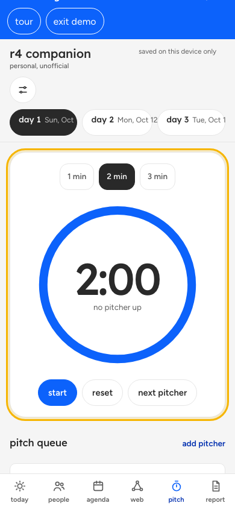
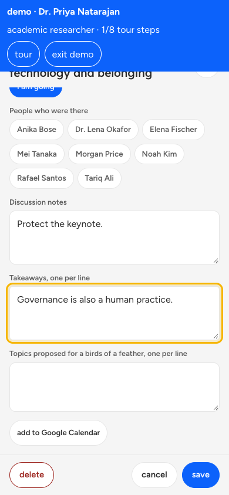
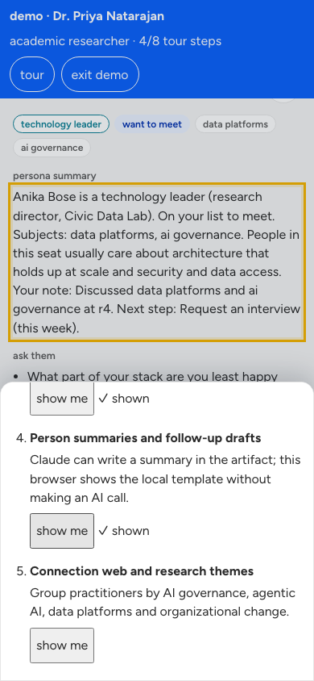

# r4 Claude persona demo

## Why this app

- **More real connections, less social cost.** Agents do the searching, asking, rejecting and scheduling backstage. People only see short moments that both said yes to. First-timers get a dinner crew, sellers get qualified conversations, researchers get interviews.
- **Respects the agenda.** Keynotes/headliners are protected, there are quiet hours and hourly caps, so networking doesn't pull people out of the sessions the sponsor paid for.
- **Follow-through.** Follow-up drafts, a recap and a report turn hallway conversations into outcomes the attendee (and their team) can act on.
- **Privacy by default.** Data stays on the device. Names are revealed only after mutual consent. Agents share topics, not contact details. There's no attendee tracking dashboard.
- **Claude's strength:** the AI notebook for the event. Paste an agenda, badge list or hallway note and structure people, sessions and follow-ups; a plain browser uses the local parser when Claude is unavailable. Goals, connection web, pitch fest, summaries, reports, and content-free signed AI receipts complete the workflow.

## Why it represents the sponsor's brand

The whole app wears the sponsor's design system. The Slalom theme uses Slalom's colours, type scale and pill buttons; it is an extension of the brand, not a white-labelled generic event app with a logo in the corner. It acts out human-centred connection with technology doing the heavy lifting backstage. Consent-first reveals, on-device data, and verifiable AI actions make responsible AI tangible. Attendees can share outcomes without creating an attendee-tracking dashboard. One toggle switches to the AiGovOps Foundation theme.

## Trust: AiGovOps Foundation, Beacon and OVERT

Beacon receipts use ULID ids, content-free SHA-256 prompt/result hashes, Ed25519 signatures over RFC 8785 canonical JSON, and a hash chain. The receipts screen supports verification and offline export. Beacon follows the OVERT envelope, an open evidence format for independently verifiable runtime evidence. No certification or conformance claim is made. A stranger can verify what happened offline, without an account and without trusting us. Receipts are tamper-evident on this device, not a server-side immutable ledger. [AiGovOps Foundation and OVERT](https://www.aigovops-foundation.com/overt.html).

## Personas

- [Maya Torres](docs/personas.md): social first-timer seeking belonging and a dinner crew.
- [Diego Alvarez](docs/personas.md): sales networker pursuing qualified conversations and co-sells.
- [Dr. Priya Natarajan](docs/personas.md): academic researcher protecting focus while conducting interviews.

## Feature map

| feature | persona | tour step |
|---|---|---|
| Quick capture and agenda/people parsing | Maya | Quick capture and AI parsing |
| People, goals and follow-ups | Diego | People and goals |
| Sessions, agenda and work blocks | Priya | Agenda and focus block |
| Connection web | Maya | Connection web |
| Pitch fest, summaries and report | Diego | Pitch and report |
| Receipt verification and export | Priya | Receipts and trust |
| Brand and language controls | Maya | Design and accessibility |

## Demo scripts

Use `?demo=maya`, `?demo=diego`, or `?demo=priya`. In this Claude artifact AI steps use Claude; in a plain browser they use the local parser.

### Maya Torres

1. Capture an agenda and browse people. 
2. Review her goal and connection web. 

### Diego Alvarez

1. Add qualified contacts and goals. 
2. Prepare a pitch and inspect the report. 

### Dr. Priya Natarajan

1. Review sessions and protect a focus block. 
2. Verify and export receipts. 

source available under PolyForm Noncommercial 1.0.0. © AiGovOps Foundation, Bob Rapp, Ken Johnston.
